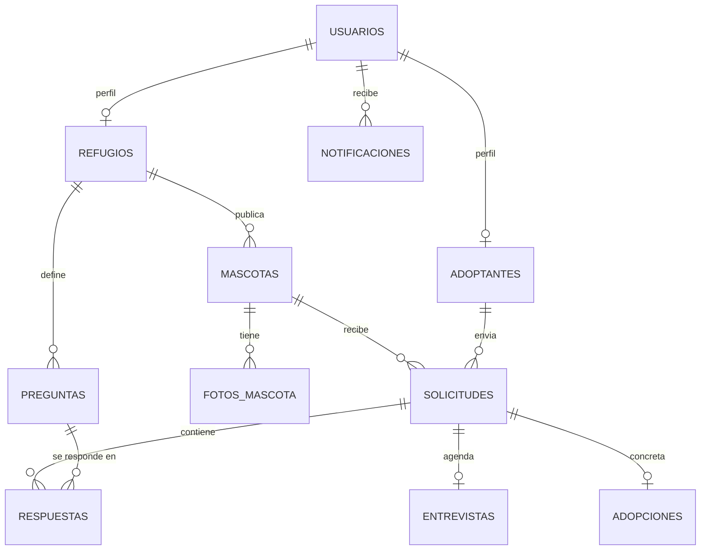
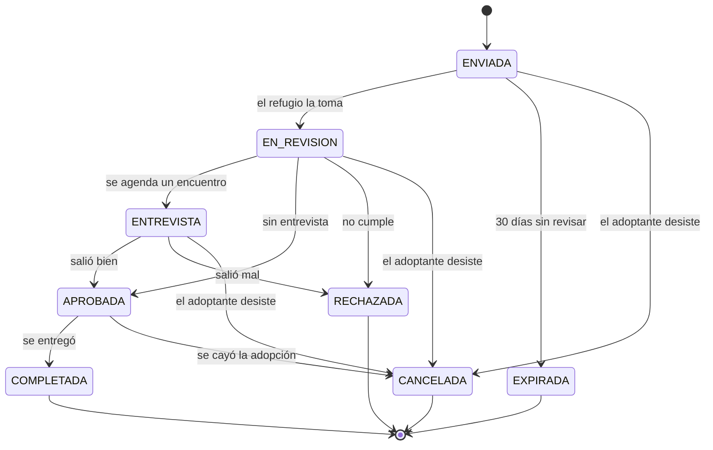
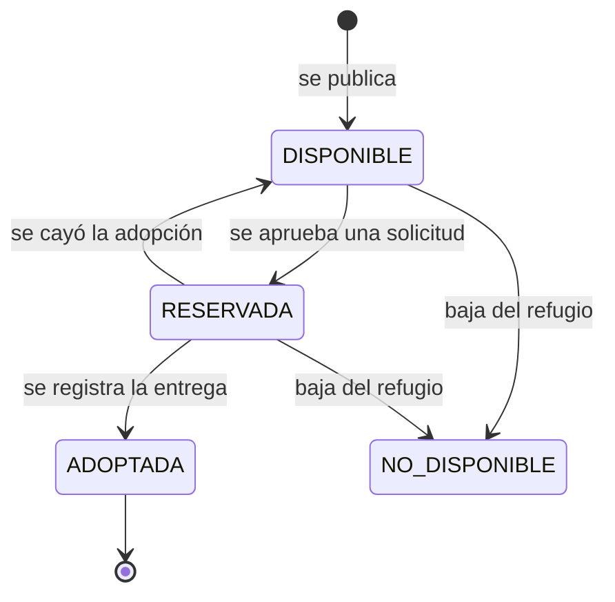

# Documentación

| Documento | Qué tiene |
| --- | --- |
| [propuesta.pdf](propuesta.pdf) | Propuesta presentada a la cátedra: alcance, stack, arquitectura y plan de trabajo |

Pendiente para la entrega:

- [ ] Diagrama de casos de uso
- [ ] Diagrama de clases del dominio
- [ ] Informe con las decisiones de diseño

## Modelo de datos

El esquema real (columnas, restricciones e índices) está en
[`V1__esquema_inicial.sql`](../backend/src/main/resources/db/migration/V1__esquema_inicial.sql).

## Ciclo de vida de una solicitud

## Ciclo de vida de una mascota

