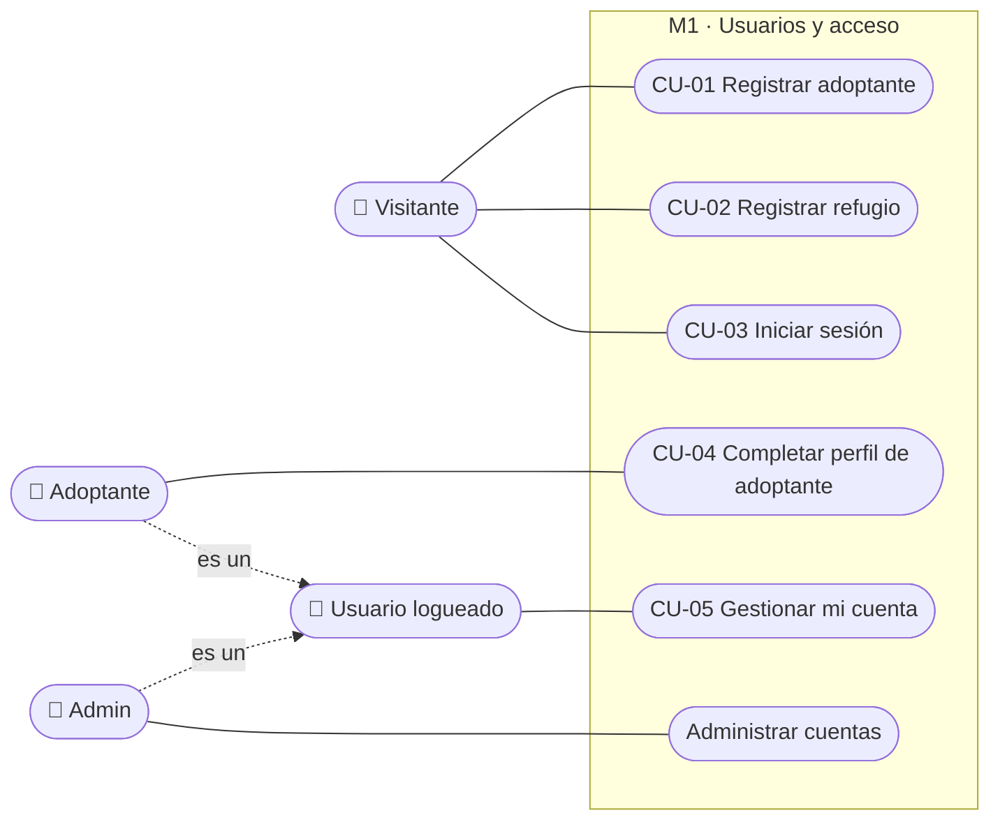
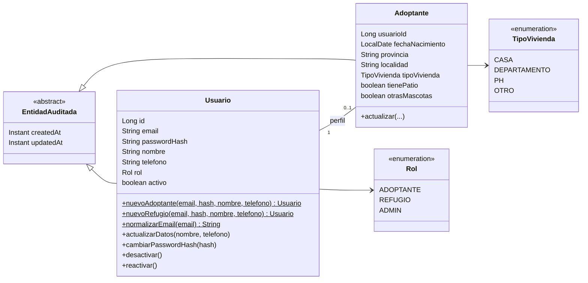
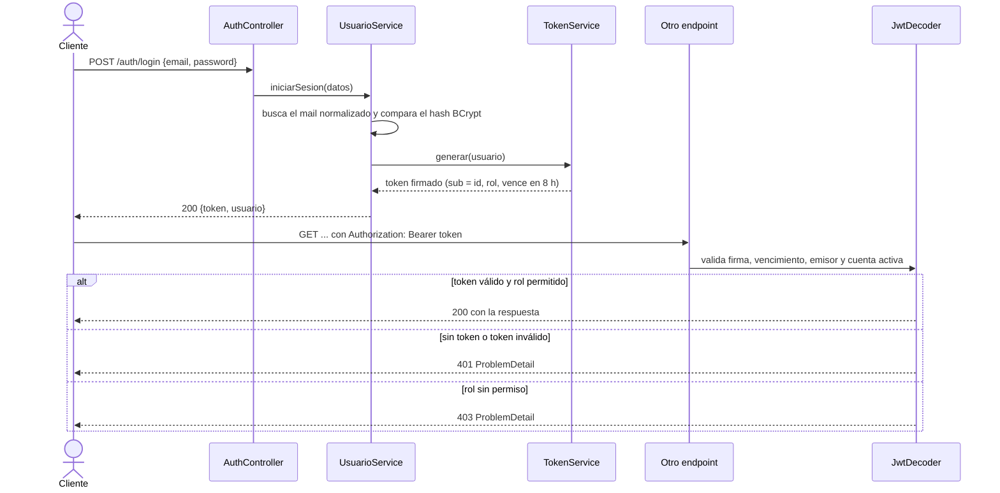

# M1 · Usuarios y acceso

Registro de adoptantes y refugios, inicio de sesión, roles y permisos, perfil del adoptante
y administración de cuentas. Código en `backend/src/main/java/com/adoptar/usuarios`.
Tablas: `usuarios` y `adoptantes` (y la ficha inicial en `refugios`, ver más abajo).

## Casos de uso

> La numeración CU-01 a CU-05 es una propuesta: el repo solo fija que M1 va de CU-01 a CU-05
> y que el perfil del adoptante es el CU-04.

| CU | Nombre | Actor | Endpoint |
| --- | --- | --- | --- |
| CU-01 | Registrar adoptante | Visitante | `POST /api/v1/auth/registro/adoptante` |
| CU-02 | Registrar refugio | Visitante | `POST /api/v1/auth/registro/refugio` |
| CU-03 | Iniciar sesión | Visitante | `POST /api/v1/auth/login` |
| CU-04 | Completar perfil de adoptante | Adoptante | `GET` y `PUT /api/v1/usuarios/yo/perfil` |
| CU-05 | Gestionar mi cuenta | Cualquier usuario logueado | `GET` y `PUT /api/v1/usuarios/yo`, `PUT /api/v1/usuarios/yo/password` |
| — | Administrar cuentas | Admin | `GET /api/v1/admin/usuarios`, `POST /api/v1/admin/usuarios/{id}/desactivar` y `/reactivar` |

## Diagrama de clases

Capas del módulo, de afuera hacia adentro:

| Capa | Clases |
| --- | --- |
| Controller | `AuthController`, `UsuarioController`, `PerfilAdoptanteController`, `AdminUsuarioController` |
| Service | `UsuarioService`, `PerfilAdoptanteService`, `AdministracionUsuariosService`, `TokenService` |
| Repository | `UsuarioRepository`, `AdoptanteRepository`, `FichaRefugioRepository` |
| Dominio | `Usuario`, `Adoptante`, `Rol`, `TipoVivienda` y las excepciones del módulo |

## Cómo funciona el login

## Reglas de negocio y dónde se controlan

| Regla | Dónde |
| --- | --- |
| El mail es único y se guarda en minúsculas | `Usuario.normalizarEmail`, `UsuarioService` y constraint en la base |
| El rol lo decide el endpoint, nunca el cliente: el admin no se registra desde afuera | Los DTO de registro no tienen campo `rol` |
| La contraseña nunca se guarda en texto plano | Hash BCrypt (`PasswordConfig`) |
| El login falla con el mismo mensaje si el mail no existe, la contraseña está mal o la cuenta está desactivada | `UsuarioService.iniciarSesion` |
| El refugio nace PENDIENTE (regla 11: solo un refugio verificado publica) | `FichaRefugioRepository.crearPendiente` |
| El CUIT es único y tiene el formato `30-12345678-9` | `RegistroRefugioRequest` y `UsuarioService.registrarRefugio` |
| Regla 4: sin perfil completo, el adoptante no puede enviar solicitudes | `PerfilAdoptanteService.exigirPerfilCompleto` |
| Nada se borra físicamente: las cuentas se desactivan | `Usuario.desactivar` |
| Una cuenta desactivada no entra más, ni con su token anterior | Validador del `JwtDecoder` en `JwtConfig` |
| El admin no puede desactivarse a sí mismo | `AdministracionUsuariosService.desactivar` |
| Para cambiar la contraseña hay que saber la actual | `UsuarioService.cambiarPassword` |

## Decisiones de diseño

- **Token JWT y sin sesiones.** El servidor no guarda quién está logueado: cada pedido trae su
  token firmado con el id y el rol. Escala sin estado compartido y encaja con un frontend
  separado. Se firma con HS256 y una clave secreta, así nadie puede fabricar un token ni
  cambiarle el rol.
- **El rol viaja en el token y las reglas por ruta están en un solo lugar** (`SecurityConfig`).
  Las reglas de negocio de cada módulo ("solo el dueño ve su solicitud") van en su service.
- **Cuenta y perfil separados.** `usuarios` tiene lo común a todos los roles y `adoptantes` lo
  propio del adoptante. "Perfil completo" es simplemente que exista la fila, una regla fácil de
  explicar y de consultar.
- **Una cuenta desactivada pierde el acceso en el acto.** Por diseño, un JWT sigue sirviendo
  hasta vencer. Para que desactivar tenga efecto inmediato, en cada pedido se controla que la
  cuenta siga activa. Cuesta una consulta simple por pedido, aceptable para este sistema.
- **Errores en un solo formato.** Los 401 y 403 que corta Spring Security salen como
  ProblemDetail (RFC 9457), igual que los errores de los controllers.
- **El registro de refugio no invade M4.** La tabla `refugios` es del módulo de refugios. El
  registro crea la cuenta y solo inserta la ficha mínima en estado PENDIENTE, en la misma
  transacción. Ver, editar y verificar el refugio sigue siendo de M4.

## Cómo lo usan los otros módulos

- **Quién está logueado:** en un controller, `@AuthenticationPrincipal Jwt token`.
  `Long.valueOf(token.getSubject())` es el id del usuario y `token.getClaimAsString("rol")` su rol.
- **Regla 4 (Solicitudes):** antes de crear una solicitud, llamar a
  `perfilAdoptanteService.exigirPerfilCompleto(adoptanteId)`. Si falta el perfil, lanza
  `PerfilIncompletoException` y la API responde 409. También está `tienePerfilCompleto(id)`.
- **Datos del adoptante (por ejemplo, para la compatibilidad con la mascota):**
  `perfilAdoptanteService.obtener(adoptanteId)` devuelve vivienda, patio y otras mascotas.
- **Refugios (M4):** cada refugio registrado ya tiene su fila en `refugios` con el mismo id que
  su usuario y estado PENDIENTE. Si M4 suma un método para crear la ficha, `FichaRefugioRepository`
  se reemplaza por una llamada a ese método.

## Límites conocidos

- Cambiar la contraseña no invalida los tokens ya emitidos: siguen sirviendo hasta que vencen (8 h).
- No hay recuperación de contraseña por mail (fuera de alcance: no hay envío de mails).
